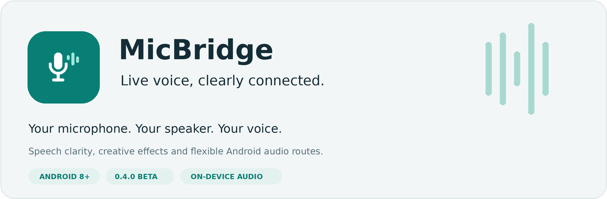
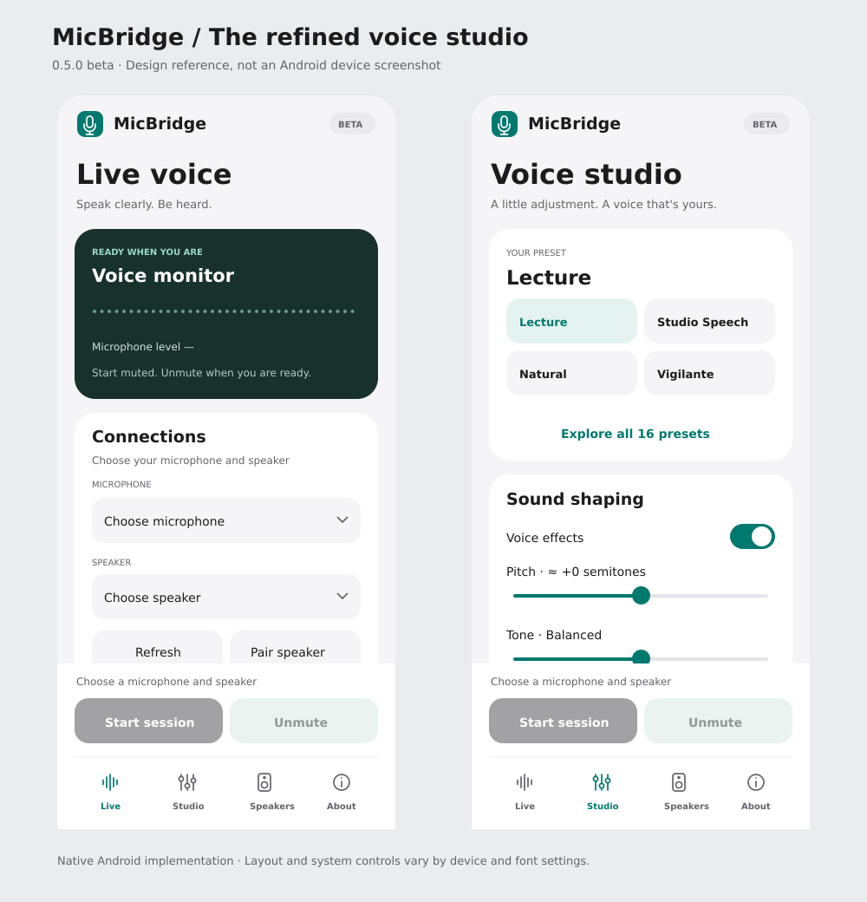

  

  <a href="dist/MicBridge-0.7.0-preview.apk"><strong>Download 0.7.0 Preview</strong></a> ·
  <a href="mailto:jerrychiengchintung@gmail.com?subject=MicBridge%20beta%20feedback%20and%20requests">Send feedback</a> ·
  <a href="docs/INSTALLATION.md">Get started</a> ·
  <a href="VOICE_PRESETS.md">Voice presets</a> ·
  <a href="CONTRIBUTING.md">Collaborate</a> ·
  <a href="https://ko-fi.com/jerrychiengct">Support on Ko-fi</a>

# MicBridge

**Your voice, amplified. Make more of the audio equipment you already have.**

Need to lead a lesson, run a workshop or give a small presentation? MicBridge turns your Android phone and a compatible speaker into a live speech setup. Speak through your phone's built-in microphone or a compatible external mic, then send your voice to your selected audio output.

Start with **Lecture** for spoken delivery, adjust your sound to suit your voice, or explore **17 original presets** for creative voice effects. MicBridge brings microphone selection, speaker selection, voice controls and live monitoring together in one clean interface.

**[Download the free Android preview](dist/MicBridge-0.7.0-preview.apk)** · Android 8.0+ · No app account required · Audio processed on your phone

## New in 0.7.0 Preview — Studio upgrade

**[Download MicBridge Preview 0.7.0](dist/MicBridge-0.7.0-preview.apk)** · Android 8.0+ · [Screen-lock setup and testing](docs/BACKGROUND_AUDIO.md)

- **All voices in Effects:** a searchable library of all 17 presets, with All, Speech and Character filters. Natural, Lecture, Studio Speech, Vigilante and Synthetic Overlord are included. Switch between Presets and Sound controls without scrolling through the whole library.
- **Four appearance choices:** Follow system, Studio Light, Graphite Dark and Midnight OLED. The theme applies to cards, text, actions, dropdowns, dialogs and system-bar appearance.
- **Simple / Studio workspace:** quick speaking controls or full EQ, creative effects, voice care and diagnostics. Both modes include every preset; switching modes changes the visible controls, not your current sound. This is an interface upgrade, with no paid tier or subscription introduced.
- **Screen-lock session support:** live audio is owned by a microphone/media foreground service. Start the session while the app is visible, then lock the screen or switch apps. An ongoing notification offers Mute/Unmute and Stop. Allow notifications to see those controls.

**Updates the existing 0.6.0 Preview in place**, using the same package and recovered preview signing key. It still installs alongside the older 0.5.x app. Settings stay with the preview app.

Screen-lock playback has been implemented and reviewed against Android guidance. Six digital suites and SDK compilation checks passed. **Physical lock/unlock, notification interaction, rendered UI and acoustic latency testing remain open.** Device firmware and battery management can affect long sessions. This is a testing preview, not a production reliability guarantee.

## Why try MicBridge?

- **Use what you already own.** Start with your phone mic and a compatible speaker; add a wired or USB microphone when you need one. Compatible wireless microphones with USB receivers are welcome too.
- **Make speaking your starting point.** Lecture and Studio Speech presets offer speech-focused tuning, with optional background-noise calibration and gentle level assistance.
- **Choose how your voice sounds.** Adjust gain, bass, mid, treble and tone, or explore pitch, grit, robot and echo effects.
- **Stay in control while speaking.** See the input level, choose both audio routes, and keep Mute and Stop within reach.
- **Keep live audio local.** Processing works on device, without microphone recordings, cloud audio processing, advertising or analytics.
- **Help shape an independent project.** Try the public beta, share your experience and suggest the features that would make it more useful.

## Who is it for?

| Your situation | A useful starting point |
| --- | --- |
| Teaching a lesson or explaining to a small group | Phone mic or external mic, Lecture preset, compatible external speaker |
| Running a workshop or giving a presentation | Studio Speech, gentle EQ adjustments, live level monitoring |
| Practising delivery or experimenting with sound | Natural, Broadcast or Warm Narrator; compare settings on your own setup |
| Making a voice-effects demonstration | Explore Vigilante, Cyber Pilot and other original presets |
| Testing everyday audio equipment | Try generic or branded devices and report what works |

MicBridge is **brand-independent**. No particular phone, microphone or speaker brand is required. It supports Android-recognised built-in, wired and USB inputs, with Bluetooth media, wired, USB and phone-speaker outputs. Compatibility depends on Android, the adapter and the selected route. Hands-free Bluetooth microphone input is not supported. Bluetooth delay varies by setup; wired or USB output is worth comparing for live speech.

## Try it. Tell me what would make it better.

**Everyone is invited to download and test MicBridge with their own compatible hardware.** Budget, generic and premium equipment are all welcome. Successful setups are just as valuable as bug reports.

Email **[jerrychiengchintung@gmail.com](mailto:jerrychiengchintung@gmail.com?subject=MicBridge%20beta%20feedback%20and%20requests)** with your experience, sound quality, delay, problems and feature requests. You can also use **About → Email feedback or a request** in the app. Include the phone/Android version, microphone or adapter, speaker connection and app settings. [Testing guide →](docs/TESTING.md)

Created by **Jerry Chieng Chin Tung**. Developers, audio engineers, designers and testers are welcome to collaborate. [Support development on Ko-fi](https://ko-fi.com/jerrychiengct).

## For reviewers and content creators

Want to show your audience a practical Android experiment? Demonstrate **phone mic → connected speaker**, then compare a speech preset and a creative voice effect. Use real audio, describe your actual setup and invite viewers to try the beta. [Media brief, demo outline and reusable copy →](docs/MEDIA_KIT.md)

## Earlier beta download and setup

For the new Synthetic Overlord voice, use **0.7.0 Preview** from the download above. The earlier beta below does not contain this preset.

**[Download MicBridge 0.5.1 beta](dist/MicBridge-0.5.1-beta.apk)** · Android 8.0 or newer · 4 October 2026

Open the APK link, then choose **Download raw file** on GitHub. This repository is public; anyone can browse the source and download the beta APK. This is an installable beta APK; there is no Play Store listing.

1. Install the APK and allow **Microphone** and **Nearby devices** permissions when requested.
2. Connect your microphone, or use **Phone microphone**. Pair your speaker in Android settings and enable **Media audio**.
3. On **Live**, select the input and output. Start with low speaker volume and gain around **1.0×**.
4. Choose **Lecture** in **Studio**, then tap **Start session**. The app checks the actual route while muted.
5. Tap **Calibrate background noise**, stay quiet for 1.5 seconds, then **Unmute**.

The 0.5.x beta requires MicBridge to stay visible; use 0.7.0 Preview for the new background-session architecture. [Full installation guide and troubleshooting →](docs/INSTALLATION.md)

## What you can do

| Feature | What it gives you |
| --- | --- |
| Flexible microphone input | Built-in, Android-compatible USB and wired microphones; mono/stereo format negotiation |
| Choose your output | Generic Bluetooth speakers, named brands, wired / USB audio and the phone speaker |
| Speech voice care | Gentle noise reduction, microphone noise-floor calibration, bounded level assist and de-essing |
| Shape your sound | Independent bass, mid and treble, warm/bright tone, pitch, grit, robot texture and echo |
| 17 original presets | Lecture, Studio Speech, Broadcast, Warm Narrator, Vigilante and more |
| Latency controls | Native burst or approximately 5 ms Fast blocks, bounded capture backlog and adaptive output buffers |
| Live monitoring | Input-level history, clipping indication, actual-route checks, persistent Mute and Stop controls |
| Appearance and workspace | System/light/dark/OLED themes, Simple/Studio controls |
| Background session | Start in the app, then use notification controls with screen locked |
| Local processing | No microphone recordings, cloud processing, advertising or analytics |

## Earlier 0.5.0 interface reference

A quieter charcoal and mint palette, large page titles, soft grouped cards and original outline icons give the native Android app an iOS-inspired visual style. This earlier design used a Studio tab. Version 0.7.0 now uses the searchable Effects library and theme-aware surfaces. Device labels wrap, controls scale with text, and each tab remembers its scroll position.

*Design reference, not an Android screenshot. Actual layout and system controls vary by device and font settings.* [Design notes](docs/DESIGN.md)

## Inside the app

| Tab | Purpose |
| --- | --- |
| **Live** | Select microphone and speaker, monitor input, calibrate noise and manage playback |
| **Effects** | Pick a preset, adjust EQ and effects, or bypass processing |
| **Speakers** | Read generic Bluetooth instructions and browse examples from 12 brands |
| **About** | Creator, public GitHub, Ko-fi, feedback / feature-request and collaboration email buttons |

The Material-style adaptive icon supports Android themed icons. The banner above is a branding graphic, not a device screenshot. Genuine interface screenshots will be added after capture on a phone or emulator; the screenshot instructions are in [Testing](docs/TESTING.md#capture-interface-screenshots).

## Start with the right preset

- **Lecture / Studio Speech:** natural pitch, speech presence, gentle leveling and voice care.
- **Broadcast / Warm Narrator:** warmer spoken delivery.
- **Crisp Presenter / Soft Spoken:** clearer consonants or bounded assistance for a quiet voice.
- **Vigilante / Cyber Pilot / Cinematic:** creative character textures.
- **Natural:** neutral processing; use **Effects bypass** to turn processing off.

All presets are original MicBridge tunings. Commercial preset packs, licensed voice models and paid plug-in engines are not included. [Full preset collection and processing references →](VOICE_PRESETS.md)

## Compatibility and latency

Microphone support depends on what Android and your adapter expose as a working audio input. Speaker support follows the audio connection, with no brand whitelist. Generic names such as **BT Speaker** or **Wireless Speaker** are welcome. [Speaker guide →](SPEAKER_GUIDE.md)

Fast mode prefers a suitable native burst at a shared native sample rate, otherwise approximately 5 ms processing blocks. **Block duration and app buffer size are not measured microphone-to-speaker latency.** Android can enlarge requested buffers, and Bluetooth speakers add their own buffering. Wired or USB output is usually the better choice when delay is distracting. Pitch effects add processing delay, and echo adds audible repeats.

Version **0.5.1** drains available capture without waiting and bounds the pending speech queue so a speaker stall cannot accumulate an unbounded app backlog. Recovery can skip old audio and eases the transition over 2 ms. Fast output buffers grow on underruns, then cautiously reduce after stable playback; a failed reduction establishes a higher floor. A causal limiter avoids block-dependent attenuation, and noise reduction now opens quickly and closes gently using sample-rate-aware timing. These are software improvements, not a promise of a specific hardware latency or studio-quality restoration.

Processing can improve levels and clarity, but cannot restore missing detail, repair transmitter clipping or prevent acoustic feedback. Keep the microphone away from the speaker. Hands-free Bluetooth microphones and phone earpieces are excluded from this media-audio engine. Built-in, USB and wired microphones remain available; unsupported combinations stay muted and stop with an error.

## Device-selection cleanup retained from 0.4.2

The input and output selectors now use one Android device snapshot, remove repeated IDs, preserve choices by identity and recheck availability before starting. Disconnecting a selected device clears that choice instead of selecting a replacement. Distinct same-name ports are numbered; Bluetooth media and LE Audio profiles remain separately labelled. Only supported route categories appear. Long labels wrap and the main controls adapt to larger text.

## Beta status

| Check | Current status |
| --- | --- |
| Android SDK 35 compilation / APK signature | Verified for 0.7.0 Preview |
| Digital audio and format-negotiation tests | Passed; scope documented in [Testing](docs/TESTING.md) |
| Upgrade signing | Same preview certificate as 0.6.0; separate from 0.5.x |
| Physical microphone / speaker combinations | Awaiting documented hardware test results |
| End-to-end acoustic latency | Not yet measured on a physical setup |
| Screen-lock operation | Implemented through a foreground service; real-device verification still needed |

[Release checklist](docs/RELEASE_CHECKLIST.md) · [Changelog](CHANGELOG.md) · [Build instructions](docs/BUILDING.md) · [Audio engine](docs/AUDIO_ENGINE.md)

## Support and collaboration

Created by **[Jerry Chieng Chin Tung](https://github.com/jerrychiengct)**. Android developers, audio engineers, designers and beta testers are welcome.

- **Collaborate:** read [Contributing](CONTRIBUTING.md), then share an idea, improvement or hardware test report.
- **Beta experiences and requests:** email **[jerrychiengchintung@gmail.com](mailto:jerrychiengchintung@gmail.com?subject=MicBridge%20beta%20feedback%20and%20requests)**. All hardware brands are welcome; please describe your actual setup.
- **Report a problem:** use the repository's [issue forms](https://github.com/jerrychiengct/micbridge-android/issues/new/choose) to report a bug or share a hardware test.
- **Support on Ko-fi:** [ko-fi.com/jerrychiengct](https://ko-fi.com/jerrychiengct). Support is voluntary and opens an external service.
- **Donate or contact Jerry:** email **[jerrychiengchintung@gmail.com](mailto:jerrychiengchintung@gmail.com?subject=MicBridge%20project%20support)** personally. Donations are voluntary; MicBridge does not collect payments.
- **Follow other projects:** visit [Jerry's public GitHub profile](https://github.com/jerrychiengct). MicBridge is a public beta project.

[Support details](SUPPORT.md) · [Privacy](PRIVACY.md)
